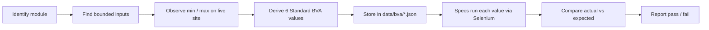

<div align="center">

# Analisis Nilai Batas (Boundary Value Analysis) pada Pengujian Black Box Gramedia.com

### Standard BVA test automation, based on the modules of Gramedia.com

-2ea44f>)


_Bugs hide at the edges, not in the middle. So we test the edges._

</div>

> Academic project, Informatics Engineering, Universitas Pancasila (Software Testing & Validation course). Not affiliated with Gramedia.

---

## Table of Contents

- [Overview](#overview)
- [Test Plan](#test-plan)
- [Test Scope](#test-scope)
- [Modules Under Test (BVA curation pending)](#modules-under-test-bva-curation-pending)
- [Why Boundary Value Analysis?](#why-boundary-value-analysis)
- [Standard BVA at a Glance](#standard-bva-at-a-glance)
- [Boundary Table (draft)](#boundary-table-draft)
- [Example Test Cases (illustrative)](#example-test-cases-illustrative)
- [How It Works](#how-it-works)
- [Project Structure](#project-structure)
- [Architecture Layers](#architecture-layers)
- [Getting Started](#getting-started)
- [Running the Tests](#running-the-tests)
- [Testing Ethics & Rules](#testing-ethics--rules)
- [Limitations](#limitations)
- [Team](#team)
- [License](#license)

---

## Overview

This repository automates **black-box, end-to-end tests** for [Gramedia.com](https://www.gramedia.com/) using **Standard Boundary Value Analysis (Type A)**.

It implements one part of the group's test strategy, defined in the report _Desain Test Strategi, Planning, Test Case dan Skenario Pada Gramedia.com_ (Assignment 04, Group 13, Human Error). The full Test Plan is in [`docs/TEST_PLAN.md`](docs/TEST_PLAN.md).

## Test Plan

Summary. Full details (strategy, resources, risks, environment) are in [`docs/TEST_PLAN.md`](docs/TEST_PLAN.md).

| Item                | Detail                                                  |
| ------------------- | ------------------------------------------------------- |
| Object under test   | Gramedia.com (<https://www.gramedia.com/>), web version |
| Test type           | Black-box, validation and system level                  |
| Reference standards | ISO/IEC/IEEE 29119-2 and 29119-3, ISO/IEC 25010         |
| Approach            | Risk-Based Testing; manual and automated                |
| Period              | 12 October to 6 November 2026                           |
| This repository     | Automated Standard BVA                                  |

**Exit criteria**

1. 100% of high-priority test cases executed.
2. At least 90% of all test cases executed.
3. No open Critical defect without documentation.
4. Test report completed.

**Milestones**

| Milestone                   | Target      |
| --------------------------- | ----------- |
| M1: Test Plan done          | 16 Oct 2026 |
| M2: all test cases reviewed | 23 Oct 2026 |
| M3: execution done          | 3 Nov 2026  |
| M4: final report submitted  | 6 Nov 2026  |

**Test environment**

| Component   | Specification                                                        |
| ----------- | -------------------------------------------------------------------- |
| Application | Gramedia.com, production                                             |
| Client      | Laptop (Chrome, Firefox, Edge, Safari), Android/iOS smartphone       |
| Resolution  | Desktop 1920x1080 and 1366x768, tablet 768px, mobile 375px           |
| Test data   | Dedicated team test account, sample products from several categories |

## Test Scope

### In-scope

| No  | Module                       | Test focus                                                                     |
| --- | ---------------------------- | ------------------------------------------------------------------------------ |
| 1   | Product Catalog & Categories | Category view, price, discount, filter, sorting, pagination                    |
| 2   | Product Detail               | Information completeness, format options, breadcrumb, images                   |
| 3   | Promo & Campaign             | Promo banners, discount price accuracy, promo page links                       |
| 4   | Store Locator                | Branch location search and display                                             |
| 6   | Content / Blog               | Article display and navigation                                                 |
| 7   | Customer Service             | "Hubungi Kami" form, WhatsApp link                                             |
| 10  | Account & Authentication     | Registration, login, logout, input validation, password reset                  |
| 11  | Cart & Checkout              | Add, change, remove items, total calculation, flow up to payment stage         |
| 12  | Payment & Shipping           | Payment method and courier options, shipping cost calculation (before payment) |
| –   | Non-functional               | Responsiveness, browser compatibility, performance, basic security             |

### Out-of-scope

| Item                                                 | Reason                                                  |
| ---------------------------------------------------- | ------------------------------------------------------- |
| Real payment transactions                            | Incur real cost                                         |
| Internal payment gateway and courier systems         | Managed by third parties                                |
| Module 9: Mobile App Channel                         | Group focuses on the web version only                   |
| Module 5: Affiliate & Partnership                    | Requires an official partnership process                |
| Module 8: Social Media Integration                   | External platform content, only link opening is checked |
| Large-scale load/stress and deep penetration testing | Risks disrupting the production site                    |
| Server, database, source code                        | No access (black-box)                                   |

## Modules Under Test (BVA curation pending)

All in-scope modules are currently BVA **candidates**. Which of them have bounded inputs, and therefore get Standard BVA test cases, will be decided in a separate curation step.

| No  | Module                       | BVA applicability |
| --- | ---------------------------- | ----------------- |
| 1   | Product Catalog & Categories | Pending curation  |
| 2   | Product Detail               | Pending curation  |
| 3   | Promo & Campaign             | Pending curation  |
| 4   | Store Locator                | Pending curation  |
| 6   | Content / Blog               | Pending curation  |
| 7   | Customer Service             | Pending curation  |
| 10  | Account & Authentication     | Pending curation  |
| 11  | Cart & Checkout              | Pending curation  |
| 12  | Payment & Shipping           | Pending curation  |

## Why Boundary Value Analysis?

System errors tend to occur at the boundaries of an input range, not at the average values in the middle. BVA targets the most common causes:

| Root cause                  | Example                                               |
| --------------------------- | ----------------------------------------------------- |
| **Logic operator mistakes** | `<=` written as `<`, or `>=` swapped with `>`         |
| **Off-by-one errors**       | Loop or limit is one unit away from the real boundary |
| **Ambiguous requirements**  | The spec never states the exact limit                 |

Benefits: fewer test cases without losing bug-detection power, high precision on error-prone areas, and **automation-ready** by design.

## Standard BVA at a Glance

For every bounded input with range `[min, max]`, each boundary gets **three critical points**:

```
        invalid       valid                          valid       invalid
  ──────── │ ───────── │ ───────── ... ───────── │ ───────── │ ────────
        min-1         min   min+1          max-1   max        max+1
       (below)     (boundary)(above)      (below)(boundary)   (above)
```

| Point   | Meaning                       | Expected |
| ------- | ----------------------------- | -------- |
| `min-1` | Just below the lower boundary | Rejected |
| `min`   | Exactly on the lower boundary | Accepted |
| `min+1` | Just above the lower boundary | Accepted |
| `max-1` | Just below the upper boundary | Accepted |
| `max`   | Exactly on the upper boundary | Accepted |
| `max+1` | Just above the upper boundary | Rejected |

> **Out of scope:** Robustness BVA (Type B), which feeds extreme values far beyond the requirement to test error-handling resilience.

## Boundary Table (draft)

> Draft. Variables and values are finalized after module curation. Values are filled in from direct observation of the live site, not guessed.

| Variable                      | Min | Max         | Source            |
| ----------------------------- | --- | ----------- | ----------------- |
| Password length               | TBD | TBD         | Registration form |
| Item quantity                 | 1   | TBD (stock) | Cart page         |
| Price filter                  | 0   | TBD         | Catalog filter    |
| "Hubungi Kami" message length | TBD | TBD         | Contact form      |

## Example Test Cases (illustrative)

Illustrative example only, not a curated module. Cart quantity with `min = 1` and `max = stock` (shown as `S`):

| ID          | Input | Class           | Expected result                    |
| ----------- | ----- | --------------- | ---------------------------------- |
| CART-BVA-01 | `0`   | Invalid (min-1) | Rejected / cannot decrease below 1 |
| CART-BVA-02 | `1`   | Valid (min)     | Accepted                           |
| CART-BVA-03 | `2`   | Valid (min+1)   | Accepted                           |
| CART-BVA-04 | `S-1` | Valid (max-1)   | Accepted                           |
| CART-BVA-05 | `S`   | Valid (max)     | Accepted                           |
| CART-BVA-06 | `S+1` | Invalid (max+1) | Rejected / stock message shown     |

ID format: `<MODULE>-BVA-<number>`. Each case records the variable, input value, class (valid/invalid), expected result, and actual result.

## How It Works



Test data is separated from test logic. Example `data/bva/cart.json` (placeholder values):

```json
{
  "variable": "quantity",
  "min": 1,
  "max": 10,
  "cases": [
    {
      "id": "CART-BVA-01",
      "value": 0,
      "class": "invalid",
      "expect": "rejected"
    },
    { "id": "CART-BVA-02", "value": 1, "class": "valid", "expect": "accepted" },
    { "id": "CART-BVA-03", "value": 2, "class": "valid", "expect": "accepted" },
    { "id": "CART-BVA-04", "value": 9, "class": "valid", "expect": "accepted" },
    {
      "id": "CART-BVA-05",
      "value": 10,
      "class": "valid",
      "expect": "accepted"
    },
    {
      "id": "CART-BVA-06",
      "value": 11,
      "class": "invalid",
      "expect": "rejected"
    }
  ]
}
```

> `max: 10` above is a placeholder. Replace it with the real observed limit.

## Project Structure

```
gramedia-bva-e2e/
├── data/
│   └── bva/                     # BVA test data per module (JSON)
├── docs/
│   └── TEST_PLAN.md             # full Test Plan from the Tugas 04 report
├── tests/
│   ├── locators/                # element selectors per page
│   ├── pages/                   # Page Object Model
│   └── specs/                   # Mocha specs (one per module)
├── utilities/                   # WebDriver setup, wait helpers
├── .env.example
├── .mocharc.json
├── package.json
└── README.md
```

## Architecture Layers

Each layer has one job, so a UI change only touches one place.

| Layer     | Folder            | Responsibility                                                        |
| --------- | ----------------- | --------------------------------------------------------------------- |
| Data      | `data/bva/`       | Standard BVA values and expected results, no code                     |
| Locators  | `tests/locators/` | Selectors only (CSS/XPath). When Gramedia changes its UI, fix it here |
| Pages     | `tests/pages/`    | User actions built on locators (type, click, read message)            |
| Specs     | `tests/specs/`    | Loop over BVA data, call page actions, assert with Chai               |
| Utilities | `utilities/`      | Driver setup, explicit-wait helpers, delay, screenshot on failure     |

Flow: `spec` reads `data` → calls `page` → page uses `locators` and `utilities` → Selenium drives the browser.

## Getting Started

**Prerequisites**

- Node.js 22+
- Latest Google Chrome
- A dedicated test account (never a personal account)

**Install**

```bash
git clone https://github.com/Ghifariezra/gramedia-bva-e2e.git
cd gramedia-bva-e2e
npm install
cp .env.example .env
```

**Configure `.env`**

```env
BASE_URL=https://www.gramedia.com
TEST_EMAIL=
TEST_PASSWORD=
BROWSER=chrome
HEADLESS=false
ACTION_DELAY_MS=1000
```

## Running the Tests

```bash
npm test                  # run everything
npm run test:auth         # Account & Authentication
npm run test:cart         # Cart & Checkout
npm run test:catalog      # Product Catalog
npm run test:cs           # Customer Service
```

> Spec files appear as modules are curated and implemented. Scripts for modules without a spec yet will report no test files.

## Testing Ethics & Rules

Tests run against the **production site**, so:

1. **No real payment transactions.** Checkout stops before final payment.
2. No load/stress testing or intrusive penetration testing.
3. Use a clean browser profile (no extensions or cache) and a dedicated test account.
4. Keep a delay between actions (`ACTION_DELAY_MS`) to avoid anti-bot and rate limits.
5. Use explicit waits, never fixed `sleep`.
6. Document results with screenshots and screen recordings.

## Limitations

Mapped to the risks in the Test Plan:

- **R4:** the site UI can change during testing, which may break selectors
- **R5:** captcha or rate limiting can block automation, so actions use delays
- **R6:** the payment flow cannot be tested end to end
- **R7:** the site may be slow or down during promotions, so runs may need repeating
- **R8:** results may differ across browsers and devices

## Team

**Group 13: Human Error**

| Name                  | Student ID | Role                                        |
| --------------------- | ---------- | ------------------------------------------- |
| Rakha Hafidz Fauzan   | 4524210082 | Test Manager                                |
| Muhammad Hilmi        | 4524210066 | QA Engineer                                 |
| Ghifari Ezra Ramadhan | 4524210041 | Automation Tester, Security Auditor (basic) |

Supervising lecturer: Dra. Sri Rezeki Candra N, M.Kom.

## License

MIT
