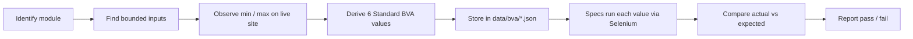

<div align="center">

# Analisis Nilai Batas (Boundary Value Analysis) pada Pengujian Black Box Gramedia.com

### Standard BVA test automation, based on the modules of Gramedia.com

-2ea44f>)


_Bugs hide at the edges, not in the middle. So we test the edges._

</div>

> Academic project, Informatics Engineering, Universitas Pancasila (Software Testing & Validation course). Not affiliated with Gramedia.

---

## Table of Contents

- [Analisis Nilai Batas (Boundary Value Analysis) pada Pengujian Black Box Gramedia.com](#analisis-nilai-batas-boundary-value-analysis-pada-pengujian-black-box-gramediacom)
    - [Standard BVA test automation, based on the modules of Gramedia.com](#standard-bva-test-automation-based-on-the-modules-of-gramediacom)
  - [Table of Contents](#table-of-contents)
  - [Overview](#overview)
  - [Why Boundary Value Analysis?](#why-boundary-value-analysis)
  - [Standard BVA at a Glance](#standard-bva-at-a-glance)
  - [Modules Under Test](#modules-under-test)
  - [Implemented Test Suites](#implemented-test-suites)
    - [Expected result types](#expected-result-types)
  - [Boundary Table](#boundary-table)
  - [Example Test Cases](#example-test-cases)
  - [How It Works](#how-it-works)
  - [Project Structure](#project-structure)
  - [Architecture Layers](#architecture-layers)
  - [Getting Started](#getting-started)
  - [Running the Tests](#running-the-tests)
  - [Test Design Notes](#test-design-notes)
  - [Testing Ethics \& Rules](#testing-ethics--rules)
  - [Limitations](#limitations)
  - [Team](#team)
  - [License](#license)

---

## Overview

This repository automates **black-box, end-to-end tests** for [Gramedia.com](https://www.gramedia.com/) using **Standard Boundary Value Analysis (Type A)**.

Test targets are taken from the modules identified in our report _Desain Test Strategi, Planning, Test Case dan Skenario Pada Gramedia.com_ (Assignment 04, Group 13, Human Error). Only modules with **bounded inputs** are covered by BVA.

## Why Boundary Value Analysis?

System errors tend to occur at the boundaries of an input range, not at the average values in the middle. BVA targets the most common causes:

| Root cause                  | Example                                               |
| --------------------------- | ----------------------------------------------------- |
| **Logic operator mistakes** | `<=` written as `<`, or `>=` swapped with `>`         |
| **Off-by-one errors**       | Loop or limit is one unit away from the real boundary |
| **Ambiguous requirements**  | The spec never states the exact limit                 |

Benefits: fewer test cases without losing bug-detection power, high precision on error-prone areas, and **automation-ready** by design.

## Standard BVA at a Glance

For every bounded input with range `[min, max]`, each boundary gets **three critical points**:

```
        invalid       valid                          valid       invalid
  ──────── │ ───────── │ ───────── ... ───────── │ ───────── │ ────────
        min-1         min   min+1          max-1   max        max+1
       (below)     (boundary)(above)      (below)(boundary)   (above)
```

| Point   | Meaning                       | Expected |
| ------- | ----------------------------- | -------- |
| `min-1` | Just below the lower boundary | Rejected |
| `min`   | Exactly on the lower boundary | Accepted |
| `min+1` | Just above the lower boundary | Accepted |
| `max-1` | Just below the upper boundary | Accepted |
| `max`   | Exactly on the upper boundary | Accepted |
| `max+1` | Just above the upper boundary | Rejected |

> On the live site, `max+1` is not always "rejected". Some fields cut the value instead (see [Expected result types](#expected-result-types)).

> **Out of scope:** Robustness BVA (Type B), which feeds extreme values far beyond the requirement to test error-handling resilience.

## Modules Under Test

| No  | Module                       | Bounded variables                                   | ID prefix  | Status      |
| --- | ---------------------------- | --------------------------------------------------- | ---------- | ----------- |
| 10  | Account & Authentication     | Email length, full name length, password length     | `AUTH-BVA` | Implemented |
| 1   | Product Catalog & Categories | Search keyword length, price filter (min, max)      | `CAT-BVA`  | Implemented |
| 11  | Cart & Checkout              | Item quantity (min 1, max = stock)                  | `CART-BVA` | Planned     |
| 7   | Customer Service             | Message field length in "Hubungi Kami" form         | `CS-BVA`   | Planned     |

Modules 2, 3, 4, and 6 have no bounded inputs and are covered by non-BVA smoke tests. Modules 5, 8, 9 and real payment transactions are **out of scope** (see Test Scope in the report).

## Implemented Test Suites

| Spec file               | Module          | Variable under test                | Case IDs                                                 | Cases |
| ----------------------- | --------------- | ---------------------------------- | -------------------------------------------------------- | ----- |
| `catalog.bva.spec.js`   | Product Catalog | Search keyword length              | `CAT-BVA-S01` to `S06`                                   | 6     |
| `price.bva.spec.js`     | Product Catalog | Min price, max price, range order  | `CAT-BVA-M01` to `M07`, `X01` to `X07`, `R01` to `R03`   | 17    |
| `register.bva.spec.js`  | Account & Auth  | Email, full name, password length  | `AUTH-BVA-E01` to `E06`, `N01` to `N06`, `P01` to `P03`  | 15    |

Total: **38 BVA cases**. `register.bva.spec.js` also contains non-BVA checks: the page opens and reaches the form, `AUTH-PRE-01` (terms checkbox precondition), and `AUTH-RULE-01` (password min-length indicator).

Case ID suffixes: `S` search, `M` min price, `X` max price, `R` range ordering, `E` email, `N` full name, `P` password.

### Expected result types

| `expect`    | Meaning                                                                 |
| ----------- | ----------------------------------------------------------------------- |
| `accepted`  | Input is kept and the feature proceeds (button enabled, results open)   |
| `rejected`  | Input is refused (button stays disabled, toast shown, URL not changed)  |
| `truncated` | The input field cuts the value at the max length                        |
| `ignored`   | Keystrokes beyond the limit are dropped by the field                    |

## Boundary Table

Values are filled in from direct observation of the live site, not guessed.

| Variable                      | Min | Max                | Behavior at max+1                    | Source            |
| ----------------------------- | --- | ------------------ | ------------------------------------ | ----------------- |
| Search keyword length         | 3   | 50                 | Truncated to 50 characters           | Navbar search     |
| Price filter (min and max)    | 1   | 10,000,000,000,000 | Extra keystroke ignored              | Catalog filter    |
| Email length                  | 1   | 254                | Truncated to 254 characters          | Registration form |
| Full name length              | 1   | 150                | Truncated to 150 characters          | Registration form |
| Password length               | 8   | TBD                | Max not observed yet                 | Registration form |
| Item quantity                 | 1   | TBD (stock)        | Not tested yet                       | Cart page         |
| "Hubungi Kami" message length | TBD | TBD                | Not tested yet                       | Contact form      |

Searching with fewer than 3 characters shows a "minimum 3 karakter" toast and does not navigate.

## Example Test Cases

Catalog search keyword with `min = 3` and `max = 50` (`data/bva/catalog.json`):

| ID          | Input length | Class           | Expected result                                  |
| ----------- | ------------ | --------------- | ------------------------------------------------ |
| CAT-BVA-S01 | `2`          | Invalid (min-1) | Rejected: toast shown, URL does not go to search |
| CAT-BVA-S02 | `3`          | Valid (min)     | Accepted: search results page opens              |
| CAT-BVA-S03 | `4`          | Valid (min+1)   | Accepted                                         |
| CAT-BVA-S04 | `49`         | Valid (max-1)   | Accepted                                         |
| CAT-BVA-S05 | `50`         | Valid (max)     | Accepted                                         |
| CAT-BVA-S06 | `51`         | Invalid (max+1) | Truncated to 50 characters in the input          |

ID format: `<MODULE>-BVA-<suffix><number>`. Each case records the variable, input, class (valid/invalid), expected result, and actual result.

## How It Works



Test data is separated from test logic. Example `data/bva/catalog.json` (shortened):

```json
{
  "variable": "search keyword length",
  "min": 3,
  "max": 50,
  "cases": [
    {
      "id": "CAT-BVA-S01",
      "description": "Search with 2 characters (min-1) shows the minimum-length toast and does not navigate",
      "length": 2,
      "class": "invalid",
      "expect": "rejected"
    },
    {
      "id": "CAT-BVA-S02",
      "description": "Search with 3 characters (min) opens the search results page",
      "length": 3,
      "class": "valid",
      "expect": "accepted"
    }
  ]
}
```

Each data file has its own case arrays (`cases`, `minCases`, `maxCases`, `rangeCases`, `emailCases`, and so on) plus module-specific expectations such as `expectedParam`, `expectedInput`, `expectedLength`, and `expectedSubmitEnabled`. `runCases()` turns every entry into one Mocha test named `<id>: <description>`.

## Project Structure

```
gramedia-bva-e2e/
├── data/
│   └── bva/
│       ├── catalog.json         # search keyword length
│       ├── price.json           # min price, max price, range order
│       └── register.json        # email, full name, password length
├── tests/
│   ├── locators/
│   │   ├── catalog.locators.js
│   │   ├── common.locators.js
│   │   └── register.locators.js
│   ├── pages/
│   │   ├── BasePage.js          # navigation retry, 429 backoff, promo guard, click/type
│   │   ├── CatalogPage.js       # navbar search
│   │   ├── StoreCatalogPage.js  # price filter on a store page
│   │   └── RegisterPage.js
│   └── specs/
│       ├── catalog.bva.spec.js
│       ├── price.bva.spec.js
│       └── register.bva.spec.js
├── utilities/
│   ├── config.js                # env-driven settings
│   ├── data.js                  # makeKeyword, makeEmail, makePassword, parsePrice
│   ├── driver.js                # Chrome WebDriver setup
│   ├── fixtures.js              # usePage(): driver lifecycle per describe
│   ├── hooks.js                 # screenshot on failed test
│   ├── screenshot.js
│   ├── shared.js                # runCases, itOpensAndShowsTitle
│   └── wait.js                  # explicit waits, pause()
├── .env.example
├── .mocharc.json
├── package.json
└── README.md
```

## Architecture Layers

Each layer has one job, so a UI change only touches one place.

| Layer     | Folder            | Responsibility                                                                                        |
| --------- | ----------------- | ----------------------------------------------------------------------------------------------------- |
| Data      | `data/bva/`       | Standard BVA values and expected results, no code                                                     |
| Locators  | `tests/locators/` | Selectors only, preferring `data-testid`. When Gramedia changes its UI, fix it here                   |
| Pages     | `tests/pages/`    | User actions on top of locators. `BasePage` adds navigation retry, 429 backoff, and promo popup guard |
| Specs     | `tests/specs/`    | Load data, call page actions, assert with Chai                                                        |
| Utilities | `utilities/`      | Config, driver, explicit waits, action delay, data generators, failure screenshots                    |

Flow: `spec` reads `data` → calls `page` → page uses `locators` and `utilities` → Selenium drives the browser.

## Getting Started

**Prerequisites**

- Node.js 22+
- Latest Google Chrome

**Install**

```bash
git clone https://github.com/Ghifariezra/gramedia-bva-e2e.git
cd gramedia-bva-e2e
npm install
cp .env.example .env
```

**Configure `.env`**

```env
BASE_URL=https://www.gramedia.com
BROWSER=chrome
HEADLESS=false
ACTION_DELAY_MS=1000
EXPLICIT_WAIT_MS=15000
PAGE_LOAD_TIMEOUT_MS=30000
# Optional
CHROME_BIN=
CHROMEDRIVER_PATH=
NO_SANDBOX=false
```

| Variable               | Default                    | Purpose                                                  |
| ---------------------- | -------------------------- | -------------------------------------------------------- |
| `BASE_URL`             | `https://www.gramedia.com` | Site under test                                          |
| `BROWSER`              | `chrome`                   | Only Chrome is supported                                 |
| `HEADLESS`             | auto                       | Forced on when no display is available (for example CI)  |
| `ACTION_DELAY_MS`      | `1000`                     | Pause after each action to stay under rate limits        |
| `EXPLICIT_WAIT_MS`     | `15000`                    | Default explicit wait                                    |
| `PAGE_LOAD_TIMEOUT_MS` | `30000`                    | Page load timeout                                        |
| `CHROME_BIN`           | empty                      | Custom Chrome binary, must exist if set                  |
| `CHROMEDRIVER_PATH`    | empty                      | Custom chromedriver, must exist if set                   |
| `NO_SANDBOX`           | `false`                    | Adds `--no-sandbox` for containers and CI                |

## Running the Tests

```bash
npm test                  # run everything
npm run test:parallel     # local parallel run
```

Run a single suite directly with Mocha:

```bash
npx mocha tests/specs/catalog.bva.spec.js     # search keyword length
npx mocha tests/specs/price.bva.spec.js       # price filter
npx mocha tests/specs/register.bva.spec.js    # registration form
```

In CI the suite runs serially with a 2 second action delay, because running three browsers in parallel triggers HTTP 429 from the site.

## Test Design Notes

**Disabled-state cases.** For cases that expect the Daftar button to be disabled, the test first fills a fully valid form and asserts the button is enabled, then swaps the field under test to the boundary value and asserts the button becomes disabled. Without that control step, a button that is disabled from the start would pass without proving anything.

**Rate limiting (HTTP 429).** The site answers "Too Many Requests" when the runner IP sends too much traffic. The suite handles it in three ways:

- `ACTION_DELAY_MS` pauses after every click and keystroke action.
- `BasePage.navigate()` allows 3 attempts. When a timeout happens and the page says "Too Many Requests", it waits `20s x attempt` (20s, then 40s) before retrying.
- Every failed navigation attempt logs the URL, title, and rate-limit flag, and saves a screenshot.

**Defect candidates.** Findings recorded in the Mochawesome report as "Defect Candidate" context instead of failing the test:

- `CAT-BVA-M07`: `?min_price=10000000000001` stays in the URL while the input is empty, so URL state and UI state disagree.
- `AUTH-BVA-E05` and `E06`: an email without `@` still enables the Daftar button. No client-side format validation was observed and there is no specification, so the test asserts only the observed behavior.

**Reports.** Specs use Mochawesome. A failed test saves a screenshot and attaches its path to the report.

## Testing Ethics & Rules

Tests run against the **production site**, so:

1. **No real payment transactions.** Checkout stops before final payment.
2. No load/stress testing or intrusive penetration testing.
3. Use a clean browser profile (the driver starts Chrome in incognito with no extensions).
4. Keep a delay between actions (`ACTION_DELAY_MS`) to avoid anti-bot and rate limits.
5. Use explicit waits for page readiness. `pause()` is only a rate-limit delay between user actions.
6. Registration tests only fill the form and never click Daftar, so no account is created.
7. Document results with screenshots and screen recordings. Review failure screenshots before publishing a report, since they may show a rate-limit page or form input.

## Limitations

- The site UI can change at any time, which may break selectors.
- Captcha or anti-bot protection may block automation.
- The site rate-limits by IP (HTTP 429), so results on shared CI runners can be flaky.
- The payment flow cannot be tested end to end.
- Cart & Checkout and Customer Service suites are not implemented yet.

## Team

**Group 13: Human Error**

| Name                  | Student ID | Role              |
| --------------------- | ---------- | ----------------- |
| Rakha Hafidz Fauzan   | 4524210082 | Test Manager      |
| Muhammad Hilmi        | 4524210066 | QA Engineer       |
| Ghifari Ezra Ramadhan | 4524210041 | Automation Tester |

Supervising lecturer: Dra. Sri Rezeki Candra N, M.Kom.

## License

MIT
