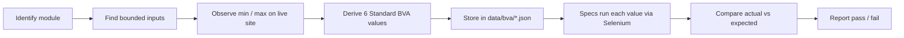

# BVA Method

How Standard Boundary Value Analysis is applied in this project. For the concrete cases, see [Test Suites](TEST_SUITES.md).

## Why Boundary Value Analysis?

System errors tend to occur at the boundaries of an input range, not at the average values in the middle. BVA targets the most common causes:

| Root cause                  | Example                                               |
| --------------------------- | ----------------------------------------------------- |
| **Logic operator mistakes** | `<=` written as `<`, or `>=` swapped with `>`         |
| **Off-by-one errors**       | Loop or limit is one unit away from the real boundary |
| **Ambiguous requirements**  | The spec never states the exact limit                 |

Benefits: fewer test cases without losing bug-detection power, high precision on error-prone areas, and **automation-ready** by design.

## Standard BVA at a Glance

For every bounded input with range `[min, max]`, each boundary gets **three critical points**:

```
        invalid       valid                          valid       invalid
  ──────── │ ───────── │ ───────── ... ───────── │ ───────── │ ────────
        min-1         min   min+1          max-1   max        max+1
       (below)     (boundary)(above)      (below)(boundary)   (above)
```

| Point   | Meaning                       | Expected |
| ------- | ----------------------------- | -------- |
| `min-1` | Just below the lower boundary | Rejected |
| `min`   | Exactly on the lower boundary | Accepted |
| `min+1` | Just above the lower boundary | Accepted |
| `max-1` | Just below the upper boundary | Accepted |
| `max`   | Exactly on the upper boundary | Accepted |
| `max+1` | Just above the upper boundary | Rejected |

> On the live site, `max+1` is not always "rejected". Some fields cut the value instead, see [Expected result types](#expected-result-types).

> **Out of scope:** Robustness BVA (Type B), which feeds extreme values far beyond the requirement to test error-handling resilience.

## Expected result types

Every case in `data/bva/*.json` carries an `expect` value:

| `expect`    | Meaning                                                                 | Example case                            |
| ----------- | ----------------------------------------------------------------------- | --------------------------------------- |
| `accepted`  | Input is kept and the feature proceeds (button enabled, results open)   | `CAT-BVA-S02`, `AUTH-BVA-E02`           |
| `rejected`  | Input is refused (button stays disabled, toast shown, URL not changed)  | `CAT-BVA-S01`, `AUTH-BVA-E04`           |
| `truncated` | The input field cuts the value at the max length                        | `CAT-BVA-S06`, `AUTH-BVA-E03`           |
| `ignored`   | Keystrokes beyond the limit are dropped by the field                    | `CAT-BVA-M06`, `CAT-BVA-X06`            |

## How it works



Boundary values are **observed on the live site**, never guessed. Test data is separated from test logic: each spec reads a JSON file and `runCases()` turns every entry into one Mocha test named `<id>: <description>`.

Example `data/bva/catalog.json` (shortened):

```json
{
  "variable": "search keyword length",
  "min": 3,
  "max": 50,
  "cases": [
    {
      "id": "CAT-BVA-S01",
      "description": "Search with 2 characters (min-1) shows the minimum-length toast and does not navigate",
      "length": 2,
      "class": "invalid",
      "expect": "rejected"
    },
    {
      "id": "CAT-BVA-S02",
      "description": "Search with 3 characters (min) opens the search results page",
      "length": 3,
      "class": "valid",
      "expect": "accepted"
    }
  ]
}
```

Each data file has its own case arrays (`cases`, `minCases`, `maxCases`, `rangeCases`, `emailMinCases`, `emailCases`) plus module-specific expectations such as `expectedParam`, `expectedInput`, `expectedLength` and `expectedSubmitEnabled`.

ID format: `<MODULE>-BVA-<suffix><number>`. Suffixes: `S` search, `M` min price, `X` max price, `R` range ordering, `E` email.
