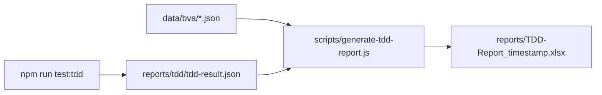

# TDD Report

Turns a test run into a spreadsheet in the manual testing **Test Case TDD** format: one row per test case with priority, steps, expected result, result and a linked bug report, plus a summary with charts.

Mochawesome alone only gives an execution report (pass or fail, duration). The TDD format is a test case document, so the generator combines two sources:



- **Test case content** (title, priority, steps, expected result) is built from `data/bva/*.json`.
- **Execution result** (Passed or Failed, duration, screenshot, defect candidates) comes from the Mochawesome JSON.

## Usage

```bash
npm run test:tdd
npm run report:tdd
```

In one line, use `;` and not `&&`, so the report is still generated when a test fails:

```bash
npm run test:tdd; npm run report:tdd
```

The file is written to `reports/TDD-Report_<date-time>.xlsx`. To use it in Google Sheets, choose **File, Import, Insert new sheet(s)**.

## Sheets

| Sheet           | Content                                                                                                      |
| --------------- | ------------------------------------------------------------------------------------------------------------ |
| `Test Case TDD` | One row per test: No, TC ID, Modul, Sub Modul, Test Case Title, Priority, Pre-condition, Steps, Expected result, Duration (minutes), Test Result, Notes, Automation ID |
| `Bug Report`    | One row per failed test: Bug ID, TC ID, Title, Severity, Steps, Expected, Actual (error message), Screenshot, Status, Date |
| `Summary`       | Totals, pass rate, results by sub modul and by priority, with one donut and two stacked bar charts          |

Details:

- **TC ID** is a formula, `$A$1&"-"&$B$1&"-"&A3`, giving `TS-194-1`, `TS-194-2` and so on. Change `TS_NUMBER` at the top of the script for another ticket number.
- **Automation ID** is the only extra column, for tracing a row back to its case (for example `CAT-BVA-S01`).
- **Dropdowns** exist for Priority, Test Result, and for Severity and Status in the Bug Report. Colors follow the selected value through conditional formatting. The dropdown rules apply down to row 500, so rows added by hand get them too.
- **Priority** is `P2-High` for invalid classes and `P3-Medium` for valid ones. Page opens, navigation and the terms checkbox precondition are `P1-Critical`.
- **Notes** holds `Open: BUG-001` (a link to the Bug Report row) for failed tests and the defect candidate text for passing ones.
- **Duration** is the test time only. Browser start and quit are not counted, so the total is lower than the wall-clock time of the run.

## Keeping it in sync

Steps and expected results are templates inside `scripts/generate-tdd-report.js`. Test Result and Duration are real.

When you add a test:

1. Add the case to the matching `data/bva/*.json` file. Cases built from data files are picked up by the generator automatically.
2. For a test without a BVA ID, add a `define(...)` entry in the generator.
3. A test the generator cannot map still appears, with module `Unmapped` and the console prints a warning.

## How the file is built

ExcelJS writes the sheets, styles and formulas. It has no chart API, and its per-cell data validation produces overlapping ranges that Excel and Google Sheets reject, so after the workbook is written the generator uses JSZip to add the dropdown rules and the three charts directly to the xlsx XML. This is why both `exceljs` and `jszip` are dev dependencies.
